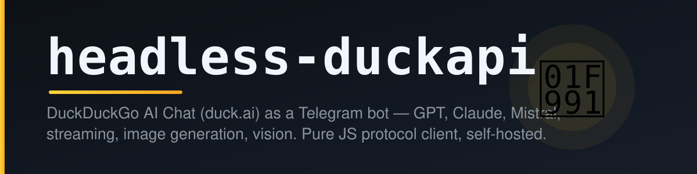

<p align="center"></p>

<h1 align="center">headless-duckapi</h1>

<p align="center"><b>Телеграм-бот на бесплатных моделях duck.ai от DuckDuckGo.<br>
Живой стриминг · GPT / Claude / Mistral · генерация картинок · понимание фото · Mini App</b></p>

<p align="center">
  <a href="README.md">🇬🇧 English README</a>&nbsp;·&nbsp;
  <a href="serverless/README.md">☁️ Вариант для Telegram Serverless</a>&nbsp;·&nbsp;
  <a href="LICENSE">MIT</a>
</p>

> **headless-duckapi** превращает чат [duck.ai](https://duck.ai) (тот самый бесплатный от DuckDuckGo — без API-ключей, без регистрации) в полноценного Telegram-бота. Внутри — **чисто JavaScript-реализация протокола duck.ai**, включая солвер антибот-челленджа, который исполняет обфусцированный JS в самодельном моке браузера. Никаких ключей OpenAI, никаких оплат.

---

## Что умеет

| | |
|---|---|
| 💬 **Стриминг** | Ответ печатается в одно сообщение в живую, токен за токеном (аккуратный троттлинг правок, перенос длинных текстов) |
| 🤖 **Модели** | GPT-5.4 mini, GPT-6 Luna, Claude Haiku 4.5, Mistral Small, GPT-OSS 120B, Gemma 4… — список тянется живьём с duck.ai со статическим фоллбеком |
| 🎨 **`/img` — картинки** | Инструмент GenerateImage: сначала черновик-превью, потом финальная картинка как фото; дневная квота на пользователя |
| 📸 **Фото-vision** | Кидай фото (JPEG сам перекодируется в PNG) и спрашивай |
| 🌐 **Веб-поиск** | Инструмент WebSearch duck.ai, переключается на чат |
| 🧠 **Размышления** | none / low / medium, настраивается на чат |
| ⚙️ **Mini App** | Настройки в стиле Телеграма (модели, размышления, поиск, очистка истории) — бот раздаёт их сам |
| 📊 **/stats** | Пользователи, источники (в т.ч. реферальные ссылки и группы), активность по дням, топ моделей, здоровье протокола duck.ai |
| 💾 **Память** | История диалога на чат в SQLite, автоочистка |
| 🦆 **Антибот-стойкость** | Токены челленджа, версии фронтенда и решённые пруфы кэшируются в базе — бот как можно реже дёргает duck.ai и не ловит 418/429 |

**Команды:** `/start` `/help` `/img` `/models` `/model` `/effort` `/web` `/reset` `/settings` `/stats` — плюс постоянное меню-клавиатура. При первом старте бот сам настраивает описание, список команд, кнопку меню и аватарку.

## Архитектура

```
                        Telegram                       duck.ai
                   (Bot API, webhook)            (недокументированный API)
                          │                              │
                 ┌────────▼─────────┐          ┌─────────▼──────────┐
                 │      app.js      │          │ bot/lib/duckai.js  │
                 │  webhook (HTTPS) │          │  клиент протокола  │
                 │  HTTP (mini app) │          │  солвер челленджа  │
                 ├──────────────────┤          │  (чистый JS, 0 dep)│
                 │ bot/handlers/*   │◄────────►│  SSE-стриминг      │
                 │ облачный код,    │  'sdk'   └────────────────────┘
                 │ 2 помеченных     │  слой
                 │     патча        │  совмес-
                 ├──────────────────┤  тимости
                 │ platform/sdk/    │
                 │  api → Bot API   │
                 │  db  → SQLite    │
                 │  fetch → Node    │
                 └──────────────────┘
```

- **`bot/`** — сама логика бота. Один и тот же код работает **без изменений** и в облаке Telegram Serverless (см. [`serverless/`](serverless/README.md)), и на любом VPS; под VPS затронуты ровно две строки (помечены `[VPS port patch]`).
- **`platform/sdk/`** — тонкий слой совместимости, реализующий облачный модуль `sdk` для Node.js: `api` → Bot API по HTTPS (с multipart-загрузкой файлов), `db` → SQLite через встроенный `node:sqlite`, `fetch` → глобальный fetch. Именно поэтому один и тот же код живёт в обоих местах.
- **`web/`** — фронтенд Mini App. Он изначально умеет оба транспорта: `Serverless.call` платформы в облаке и обычный `POST /api/settings` с подписанным `initData` при самостоятельном хостинге.

## Быстрый старт (Docker)

```bash
git clone https://github.com/<your-username>/headless-duckapi.git && cd headless-duckapi
cp .env.example .env          # впиши токен бота в .env
docker compose up -d --build
```

Готово — открой бота в Телеграме и напиши `/start`. Логи: `docker compose logs -f`.

## Быстрый старт (нативно)

Node.js **≥ 22.5** (рекомендую 24 — SQLite встроена, поэтому `npm install` ставит ноль зависимостей):

```bash
git clone https://github.com/<your-username>/headless-duckapi.git && cd headless-duckapi
npm install
cp .env.example .env          # впиши токен бота в .env
node app.js
```

Чтобы жил как сервис:

```bash
sudo cp systemd/duckai.service /etc/systemd/system/
# поправь User=/WorkingDirectory=/EnvironmentFile= под свою установку
sudo systemctl daemon-reload && sudo systemctl enable --now duckai
journalctl -u duckai -f
```

> Токен — в **@BotFather → твой бот → API Token**. Запускай либо эту копию, либо Serverless-копию на одном токене, но не обе сразу (при старте VPS-версия перенаправляет webhook на себя — побеждает та, что запущена последней).

## Конфигурация (`.env`)

| Переменная | Нужна | Что делает |
|---|---|---|
| `BOT_TOKEN` | ✅ | Токен бота из @BotFather |
| `ADMIN_IDS` | — | Telegram id через запятую, кому доступен `/stats`. Автор проекта зашит как админ по умолчанию — добавь свой id |
| `WEBAPP_URL` | — | Публичный `https://`-адрес этого хоста для кнопки 🎛 Настройки (Mini App). Телеграм принимает только `https`; если пусто — кнопка скрывается, всё то же самое доступно через `/settings` |
| `WEBHOOK_URL` | — | Публичный `https://`-адрес для апдейтов; при старте бот регистрирует `<WEBHOOK_URL>/api/webhook`. По умолчанию берётся `WEBAPP_URL`. Если ни один не `https://` — бот откатывается на long polling |
| `WEBHOOK_SECRET` | — | Значение, которое Телеграм шлёт в `X-Telegram-Bot-Api-Secret-Token` (1–256 символов `A-Za-z0-9_-`); если пусто — выводится из `BOT_TOKEN` |
| `PORT` | — | HTTP-порт Mini App/API (по умолчанию `8080`) |
| `DATA_DIR` | — | Папка SQLite-хранилища (по умолчанию `./data`) |

### Webhook и Mini App по HTTPS

Апдейты бот принимает через webhook, а Mini App раздаёт сам — всё на `PORT`. Для webhook и кнопок `web_app` Телеграм требует `https://`, так что поставь TLS-прокси и пропиши `WEBAPP_URL` (он же используется для webhook, если не задан `WEBHOOK_URL`):

```bash
# /etc/caddy/Caddyfile — Caddy сам получает сертификаты
duck.example.com {
    reverse_proxy 127.0.0.1:8080
}
```

Потом `WEBAPP_URL=https://duck.example.com` в `.env` и рестарт — в логе появится `webhook set to https://duck.example.com/api/webhook`. Без https бот тоже работает, через long polling. См. [`examples/Caddyfile`](examples/Caddyfile).

### Оверрайды на живую (таблица config)

Без правки кода, через CLI (или любой SQLite-клиент на `data/duck.db`):

```bash
node app.js config set img_enabled true      # вкл/выкл /img ('false' выключает)
node app.js config set img_model gpt-6-luna  # модель картинок (по умолчанию gpt-6-luna)
node app.js config set img_daily_limit 3     # дневная квота /img на пользователя
node app.js config list                      # что задано
node app.js setup                            # переприменить описание/команды/аватар
```

## Как устроен протокол duck.ai

Самое интересное в проекте — [`bot/lib/duckai.js`](bot/lib/duckai.js), ~42 КБ чистого JavaScript без единой зависимости:

1. `GET /duckchat/v1/status` отдаёт `x-vqd-hash-1` — **JS-челлендж** в base64.
2. Челлендж — обфусцированный JS, фингерпринтящий браузер (парсинг DOM, `NodeList`, семантика `window`, тайминги). headless-duckapi решает его в **самодельном моке браузера** (`buildBrowserMock`): HTML5-фрагментпарсер, честный обход дерева в `querySelector`, класс `NodeList`, `[object Window]` через `Symbol.toStringTag` — сверено на четырёх пойманных вариантах челленджа. Решение хешируется SHA-256 и упаковывается в ожидаемый формат метаданных.
3. `GET https://duck.ai/` отдаёт версию фронтенда (`x-fe-version`), тоже кэшируется.
4. `POST /duckchat/v1/chat` с решённым токеном стримит ответ SSE-потоком. Инструменты (веб-поиск, генерация картинок) едут в том же стриме.

Решённые токены, версии фронтенда и счётчики протокола хранятся в SQLite (`config` / `duck_daily`), поэтому рестарты не тревожат эндпоинт челленджа — так бот и не ловит 418/429. Протокол изначально портирован из [aurora-develop/Duck2api](https://github.com/aurora-develop/Duck2api) (Go), потом захарденен и расширен.

## Демо

> *плейсхолдер — тут будут скриншоты/GIF*

## Если что-то не так

| Симптом | Что это / что делать |
|---|---|
| `getUpdates conflict: another getUpdates/webhook instance is running` | Только в режиме polling: Serverless-копия этого бота всё ещё задеплоена на тот же токен. Останови одну из копий. |
| `webhook last error reported by Telegram: …` | Телеграм не может достучаться до `<WEBHOOK_URL>/api/webhook` — проверь DNS, TLS и что прокси ведёт на `PORT`. |
| `Telegram auth failed: Unauthorized` | Неверный `BOT_TOKEN` — сверься с @BotFather. |
| 418/429 в чате | duck.ai режет частоту; бот сам ретраит со свежими токенами. Если повторяется — подожди пару минут. |
| Нет кнопки 🎛 Настройки в меню | `WEBAPP_URL` не задан или не `https://` — см. раздел про Mini App. |
| `headless-duckapi needs SQLite…` на старте | В твоём Node нет `node:sqlite` (нужен ≥ 22.5; на 22.x запускай `node --experimental-sqlite app.js`), а `better-sqlite3` не собрался. Обнови Node или `npm install better-sqlite3`. |
| Бот молчит в группах | Так задумано: privacy mode + в группах отвечают только команды. |

## Или на Telegram Serverless

Тот же бот изначально написан под бесплатную платформу Telegram Serverless — VPS вообще не нужен. Нетронутый облачный проект лежит в [`serverless/`](serverless/README.md) с инструкцией деплоя (`tgcloud push && tgcloud migrate --safe`).

## Кредиты и лицензия

- Основа протокола: [aurora-develop/Duck2api](https://github.com/aurora-develop/Duck2api)
- Написан под платформу Telegram Serverless; VPS-порт, хардненинг челленджа, генерация картинок и метрики
- MIT — см. [LICENSE](LICENSE)
